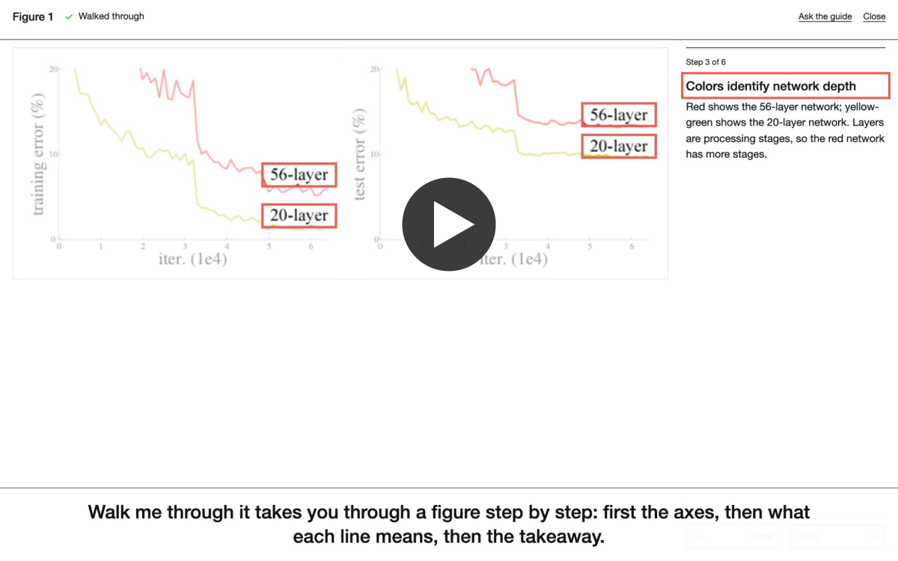
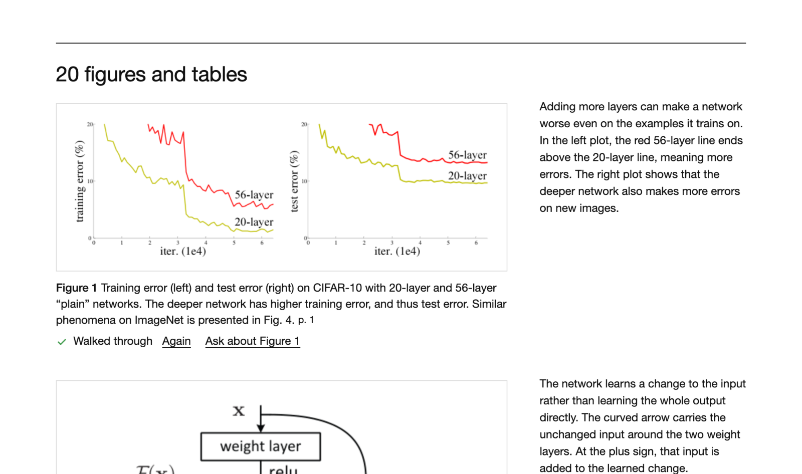
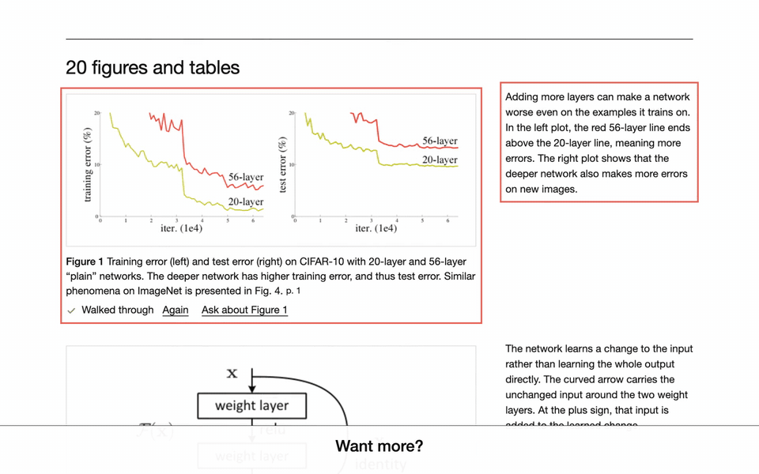
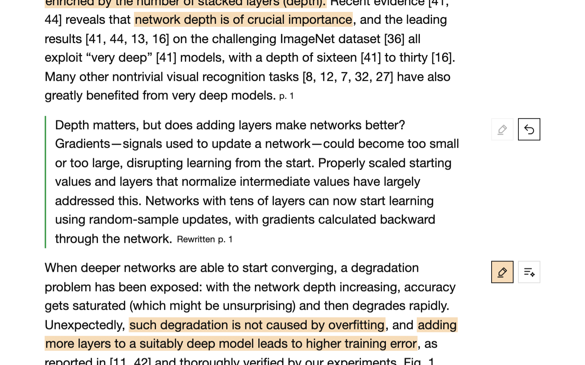
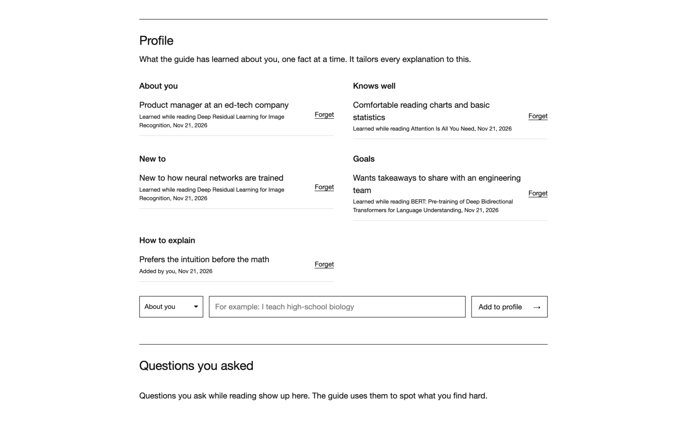

# Paper Reader

Read research papers the way Andrew Ng suggests: in four passes, from the big picture down to the math, with a guide that explains every figure in plain words.

A local web app built on the [OpenWorker](https://github.com/andrewyng/openworker) Harness SDK.

<p align="center">
  <a href="docs/demo.mp4"></a>
  <br>
  <a href="docs/demo.mp4"><b>Watch the one-minute demo</b></a> (narrated, with captions)
</p>

## What it does

### Four passes, one screen each

Pass 1 is the title, abstract and figures. Pass 2 adds the introduction and conclusion, with every other section as a one-line skim. Pass 3 is the full text with the equations folded away. Pass 4 is everything, ending with four questions to answer in your own words. A pass is marked done when you reach its end.


### Every figure and table, with its takeaway

Figures and tables are cut out of the PDF as images, including two-column layouts, side-by-side tables and side captions. Each gets a side note saying what it shows, in plain words.



### Walk me through it

A step-by-step tour of any figure, with boxes, circles, arrows and labels drawn on it. Graphs go axes first, then the data, then the takeaway. Flow charts go stage by stage. Tables go rows, columns, then the comparison that matters.



### A guide that sees what you see

Each pass opens with a short walkthrough from the guide. Ask it anything: when a figure is open, your question carries a picture of exactly what is on screen, highlights included.


### Key points highlighted, any paragraph in plain words

Key phrases in every paragraph are highlighted as soon as a paper is added. Any paragraph can be rewritten in plain words, with one click to undo.



### A library that tracks your progress, and a profile that learns about you

Add papers from arXiv or as PDFs. The library shows how far you have read. As you ask questions, the guide builds a profile of you, one fact at a time, and every explanation uses it.



## Run it

```bash
npm install
python3 -m venv .venv && .venv/bin/pip install -r requirements.txt
node server.mjs            # http://localhost:4360
```

With portless installed, `portless paper-reader node server.mjs` serves it at https://paper-reader.localhost.

The model is `gpt-6-astra` through the OpenAI Responses API. Set `OPENAI_API_KEY` in the environment or in a `.env` file in this folder. Set `PAPER_READER_ENV` to read another `.env` file, or `PAPER_READER_MODEL` to use another model. Your library, notes and profile stay on your computer, in `data/`.

## How it works

- `ingest.py`: PDF to `paper.json`, figure and table crops (PyMuPDF; tables are matched with `find_tables`), positions of the text inside each figure, and equation images. Bump `PAPER_VERSION` (and the copy in `server.mjs`) to have saved papers re-read on the next start
- `grid.py`: draws a labelled 10% grid over a figure so the walkthrough model can read positions
- `lib/agent.mjs`: the OpenWorker harness and its agents: the reading guide, the figure note writer, the figure walkthrough writer, and a helper for highlights, rewrites and the reader profile
- `lib/store.mjs`: library, per-paper state and the profile, saved as JSON under `data/`
- `server.mjs`: HTTP API and static files
- `public/`: the app

Agent definitions can't be changed once created. If you change an agent's instructions, also change its name (for example `figure-noter-v2`) and bump `NOTES_VERSION`.

### Rebuilding the demo video

`docs/demo/` holds the script, shot list and build. Read a few papers into a separate data folder, start a server on it (`PAPER_READER_DATA=demo-data PORT=4410 node server.mjs`), match the paper ids in `docs/demo/script.mjs`, then:

```bash
node docs/demo/capture.mjs                                  # screenshots and element positions
CARTESIA_API_KEY=… DEMO_VOICE_ID=… node docs/demo/build.mjs   # narration, captions, highlights, docs/demo.mp4
```

The narration is one Cartesia call that returns a time for every word; each shot, highlight and caption starts on its words.

## License

MIT. See [LICENSE](LICENSE).
