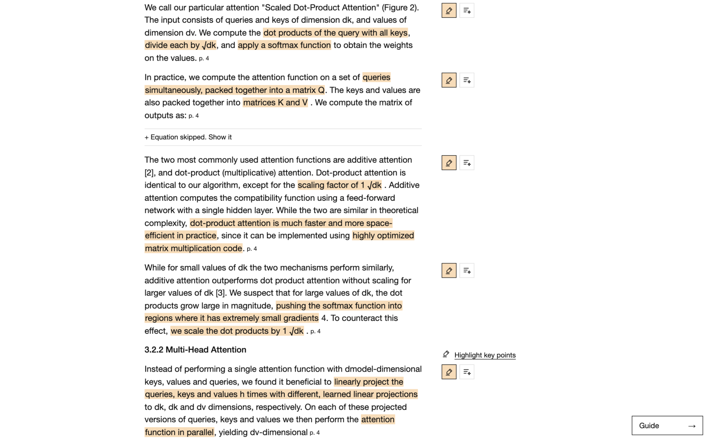
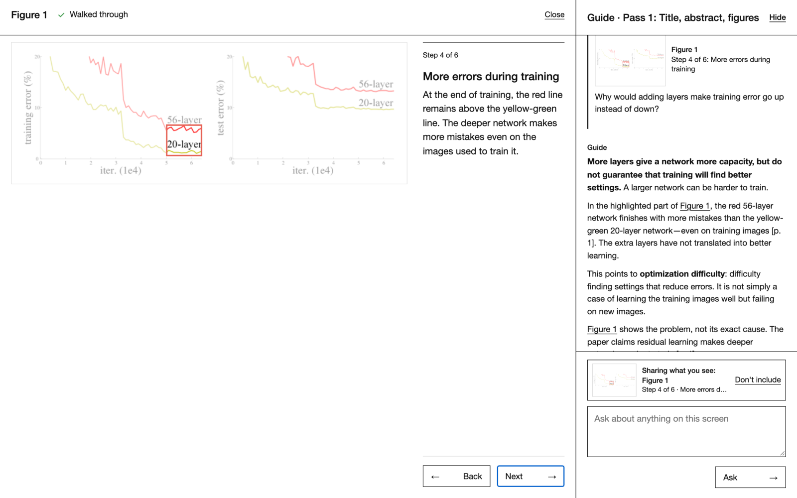

# Paper Reader

Read research papers the way Andrew Ng suggests: in four passes, from the big picture down to the math, with a guide that explains every figure in plain words.

Built on [OpenWorker](https://github.com/andrewyng/openworker).

<p align="center">
  <a href="docs/demo.mp4"></a>
  <br>
  <a href="docs/demo.mp4"><b>Watch the one-minute demo</b></a> (narrated, with captions)
</p>

## What it does

### Four passes, one screen each

Pass 1 is the title, abstract and figures. Pass 2 adds the introduction and conclusion, with every other section as a one-line skim. Pass 3 is the full text with the equations folded away. Pass 4 is everything, ending with four questions to answer in your own words. A pass is marked done when you reach its end.



### Every figure and table, with its takeaway

Figures and tables are cut out of the PDF as images, including two-column layouts, side-by-side tables and side captions. Each gets a side note saying what it shows, in plain words.


### Walk me through it

A step-by-step tour of any figure, with boxes, circles, arrows and labels drawn on it. Graphs go axes first, then the data, then the takeaway. Flow charts go stage by stage. Tables go rows, columns, then the comparison that matters.


### A guide that sees what you see

Each pass opens with a short walkthrough from the guide. Ask it anything: when a figure is open, your question carries a picture of exactly what is on screen, highlights included.



### Key points highlighted, any paragraph in plain words

Key phrases in every paragraph are highlighted as soon as a paper is added. Any paragraph can be rewritten in plain words, with one click to undo.


### A library that tracks your progress, and a profile that learns about you

Add papers from arXiv or as PDFs. The library shows how far you have read. As you ask questions, the guide builds a profile of you, one fact at a time, and every explanation uses it.


## Try it

```bash
npm install
python3 -m venv .venv && .venv/bin/pip install -r requirements.txt
OPENAI_API_KEY=… node server.mjs   # then open http://localhost:4360
```

Everything you read and everything it learns about you stays on your computer.

## License

MIT. See [LICENSE](LICENSE).
